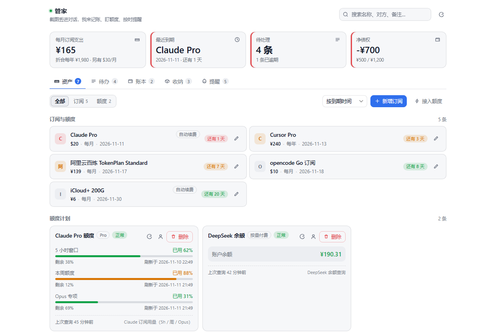
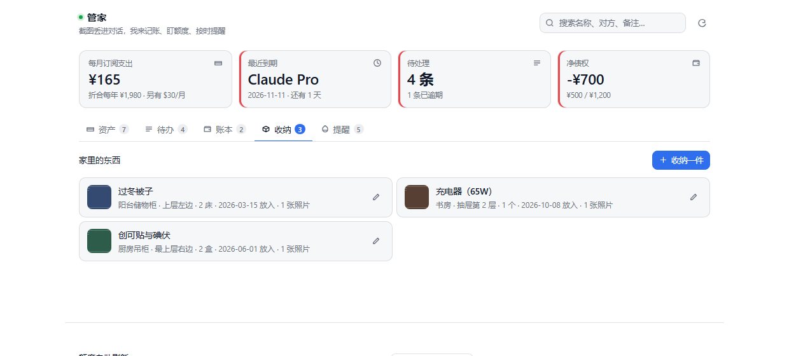

# 桌面私人管家 · DeepSeek Harness 插件

把截图丢进对话，AI 认出你在干什么，然后把它记成一条**会到期提醒**的记录。



<sub>上图是面板的资产页：四张汇总卡 + 按到期排序的订阅（宽屏两列，标题最多两行）+ 额度卡片（5 小时 / 周 / 月三条进度条，余额型直接显示余额）。深色模式见 [docs/panel-dark.png](docs/panel-dark.png)。</sub>

| 你发的截图 | 管家记成 | 之后会发生什么 |
|---|---|---|
| 软件订阅页（名称 / 金额 / 到期时间） | **资产** | 面板按到期排序，到期前提醒你 |
| Token 套餐用量页（5 小时 / 周 / 月） | **额度计划** | 30 秒轮询余量，超阈值提醒；串行查询，不拖慢宿主机 |
| QQ / 微信里「别人让你做什么」或「你要提醒谁」 | **待办** | 提前提醒 + 到点加强提醒，非确认不可 |
| 借钱 / 还钱聊天记录 | **借贷** | 到约定日期提醒；结清后不计入合计 |
| 家里某个柜子/箱子的照片，或一句「XX 放哪了」 | **物品收纳** | 记下位置+数量+时间，**图片一起存本地**；以后问「XX 在哪」直接回答 |

它不自己配模型，也不向你要 API key：**AI 能力直接用 DeepSeek Harness 内置的**，你只需要把截图发进去。

---

## 1. 安装（3 步）

1. 把本仓库放到本机任意目录，例如 `~/plugins/dsh-personal-butler`。
2. 在 DeepSeek Harness **对话里**说一句：

   > 把 `~/plugins/dsh-personal-butler` 装成插件

   （Agent 会调用宿主的 `plugin_manager install_bundle`；也可以在你的版本里用「设置 → 插件」的本地安装入口。**不要手改** profile 的 `package.json` / `cordis.patch.yml`。）
3. 侧栏出现 🔔 **管家** 图标，点开就是面板。装完不需要重启宿主。

装的是「这个目录」的链接，所以以后 `git pull` 拿到新版本、Host 半片会自动重载，**面板刷新页面即可**。

**依赖**：宿主需已挂载 `dsh-tools`、`dsh-host-webserver`、`dsh-client-ui-slots`（桌面版默认都有）。
**提醒功能**额外需要 `dsh-schedule`；没挂也能正常记账，只是不建提醒（面板「高级」里 `scheduleAvailable: false`）。

---

## 2. 第一次用：截图 → 确认 → 面板可见

1. 把截图拖进对话，加一句「记一下」。
2. 管家走四步：**查重 → 认意图抽字段 → 弹确认卡 → 写入**。
   确认卡里能改任何字段（金额、周期、提前多久提醒），**改完才落库**。
3. 拿不准的字段它不会编，会问你（这是设计，不是笨）。
4. 写完刷新面板，记录已经在列表里，提醒也已排好。

也可以直接说，不用截图：

- 「帮我记一下这个订阅，每月 20 美元，12 月 10 号到期」
- 「这个 Claude 套餐帮我盯着余量」
- 「张三让我周五前把合同发他，提醒我周四晚上看一眼」
- 「我借给李四 500，说好下个月 1 号还」
- 「这箱东西放阳台柜上层了，帮我记一下」（配图更好）
- 「我的充电器放哪了？」

> 续费不用交代：同一款软件（名称忽略大小写/空格）的旧记录已经过期时，再丢一张新一期截图，管家会把**原来那一条**续期到新到期日，不会多出一条重复的；确实是第二个账号时，跟它说一句「这是我另一个账号」即可并存。

### 在 QQ / 手机上确认（没有按钮也能回）

每条要你选择的问题，管家都会同时给你**一段带编号的文字**：

```
【确认订阅】Claude Pro 每月 $20，12 月 10 日到期，记成这样对吗？
1. 对，就这样记
2. 金额不对
3. 日期不对
直接回数字就行（比如「1」）。这条 120 分钟内有效，过期就不作数了。
```

管家**不用** DSH 的提问卡片（那张卡片只在桌面界面里能点），所有确认都是上面这种编号文字，
QQ、微信、手机上直接回一个「1」即可 —— 问题存在管家自己的账本里（`pending`），
**换个会话回也算数**，不需要你回到当时那个窗口。时效内回答有效；选「1」且这一步本来就要落库时，会直接写进记录。

> **为什么特意不用提问卡片？** 为了保证 QQ 机器人里也能正常用。
> DSH 的提问卡片要靠 QQ 插件把「某一轮对话」转发到 QQ；一旦会话没被它跟踪（提醒投递到新会话、你在手机上回、换了窗口），
> 卡片就只留在桌面界面里，QQ 那边没有按钮、也看不到选项，整轮会停在「等待回答」。
> 所以管家的确认从设计上就只依赖文字：编号写进消息正文，回答按编号落库，任何通道都能完成。
> 如果你看到管家弹了 DSH 的提问卡片，那是提示词没被遵守，属于 bug，请提 issue。

---

## 3. 面板怎么用

面板按「工作台」组织：先看重点，再动手，全程不弹窗。

- **顶部四张卡**：本月订阅支出（含折合每年）、最近到期的一个、待处理条数、净债权。点一下跳到对应页签；左侧色条 = 紧急度。
- **工具行**：搜索（名称/厂商/备注/位置）、刷新；每个页签自带筛选与排序。
- **五个页签**：

| 页签 | 能做什么 |
|---|---|
| 资产 | 按到期日排序，右侧写「还有 N 天」；**点任意一行就地改**（金额/周期/到期日/提前量）；额度卡片里是 5h·周·月进度条，缺凭证直接给「填入凭证」 |
| 待办 | 未完成 / 全部 / 已完成；「我要做」「等别人」分栏；圆圈一键完成，逾期红标 |
| 账本 | 未结清 / 全部；收/付分色，金额大字；一键结清 |
| 收纳 | 家里的东西放在哪：缩略图 + 位置 + 数量 + 放入时间；点大图看细节，点行就地改位置/数量 |
| 提醒 | 到期与额度告警，按紧急度排序，可单条或全部确认 |

- **设置页**（设置 → 管家）：额度自动刷新间隔、默认提前多久提醒、默认币种、提醒服务状态。数据路径等排错信息收在「高级」里。

---

## 4. 额度监控：内置四家 + 让模型写任意平台

额度查询要读**第三方官网的用量接口**，凭证由你自己提供（API key / 官网 cookie / OAuth token，看平台）。⚠️ 这条凭证和 Harness 的模型 key **是两回事**，不要互相复用；凭证存在宿主 credentials 里，不进配置文件、不进数据文件、不进会话记录。

内置源：

| sourceId | 平台 | 拿到什么 | 凭证 |
|---|---|---|---|
| `claude-usage` | Anthropic | 5 小时 / 7 天窗口 | OAuth token |
| `deepseek` | DeepSeek | 账户余额 | API key |
| `openai` | OpenAI | 月度用量 | 平台会话 key |
| `generic` | 任意 | 由 `config.quotaSources` 驱动 | 按你配的 header |
| `manual` | 不联网 | 手动填窗口值 | 不需要 |

**内置不够用**（Cursor、Windsurf、Kimi、自建网关……）→ 说一句「帮我盯着 XX 的额度」，模型会自己写查询代码：

1. 先 `butler_source_list` 看有没有人写过，避免重复造。
2. 模型摸接口、向你要凭证，写一段 `async ({ http, credential, kit }) => [...窗口]`。
3. `butler_source_test` **真跑一次**，把窗口和原始响应样本摊给你看（敏感值自动打码）。
4. 你说「可以」→ 保存 → 建计划 → 30 秒轮询接管。

硬门槛由服务端拦着，不靠自觉：**没试跑过的代码不许保存**；代码里不许写凭证字面量；`hosts` 不许写 `*`；还有计划在用的源不许删。面板「设置 → 额度来源」能看全部来源（内置/自己写的），带 `试跑 / 看代码 / 删除`。

> **安全边界（如实说）**：查询代码默认跑在独立 worker 线程里（死循环会被终止，不卡宿主），网络只能经注入的 `http` 桥访问你登记的域名，有超时与体积上限，日志与错误统一抹密。
> 但 `vm` **不是安全沙箱**——注入宿主对象本身留了逃逸面。请把这段代码当成「你自己写的脚本」，**只保存你确认过的代码**。

---

## 5. 收纳：家里的东西放在哪

丢一张照片加一句「记一下」，或者直接说，都行：

- **拍照/截图** → 「这箱东西放阳台柜上层，2 床被子」→ 记下名称、位置（房间 · 更细的层/格）、数量、放入时间，并**把这条消息里的图一起存进管家自己的数据目录**（会话记录清了，图还在）。一次发多张（柜子全貌 / 抽屉内部 / 标签特写）会全部存，一件东西最多 12 张。
- **直接说** → 「备用钥匙放玄关抽屉第 2 层了」→ 没图也能记。
- **问** → 「我的充电器放哪了」「玄关 钥匙」→ 按名称/位置/备注搜（多个词按「都要命中」匹配），回你位置、数量、放的时间、有没有照片。
- **换位置** → 「充电器挪到书房抽屉了」→ 更新同一条，不会变成两条；只改位置时别的地方不会被清空。
- **拿走/清掉** → 让管家删，自己独占的照片文件一起清；被别的记录引用的图会保留。
- **加图 / 换图** → 「再拍一张抽屉里面」→ 新图**追加**在原记录上，旧图不会被冲掉；要把某张摘掉就说「把那张旧图删了」，它会连文件一起清（还被别的记录引用则保留）。面板里改图是「所见即所得」：保存时以你看到的这组为准。

几个细节：

- **位置至少给一个**（房间或柜子都行），「更细的位置」可选（第 2 层 / 左边）；两者至少填一个。
- **只认真图**：按文件头字节判断 jpg/png/gif/webp，改扩展名骗不过；单张上限 50MB（从手机或 QQ 原图直接存也够），远程图片下载超时 5 分钟；面板上传前先把长边缩到 1600 转 JPEG，日常只会存下几百 KB。
- **总量有上限**：照片最多 300 张 / 1GB，超了会让你先删；启动时会把「文件没了」的记录、「没有记录」的孤儿文件、物品上的死链一起清掉。
- 照片存在 `<数据目录>/photos/`，面板经 `/butler/api/photo/<id>` 读；文件名由服务端生成，读取前校验仍在照片目录内；响应头的类型只从扩展名白名单推导。
- 如果配了 `apiToken`（见第 9 节），图片链接会自动带 `exp + 签名`——`` 带不了请求头，靠签名放行，所以加固之后照片照样能看。
- **QQ / 微信里发的图也能存**：机器人给你的图有两种形态——本地文件路径（`.dsh-qqbot/media/xxx.jpg`）或 https 链接（`multimedia.nt.qq.com.cn/download?...`），管家两种都会读。链接有时效（大约几分钟），所以别隔太久再让它记。
- 管家只挑**最近一条带图的消息**（往回看 4 条用户消息）：先发图、聊两句确认、再说位置，也能把那张图挂上；再早的截图不会被翻出来，同一张图也不会重复存。



---

## 6. 提醒是怎么响的

管家不自己造定时器，而是把每条记录**对账**到宿主 `dsh-schedule`（所以你能在 Automation tasks 里看到「管家提醒 · xxx」并干预）：

- 有明确时间 → 建两条：**提前提醒**（默认提前 30 分钟）+ **到点提醒**。
- 到点提醒要求模型**必须让你当场表态**（已处理完 / 我这就去 / 延后 10 分钟 / 延后到明天）——「加强提醒」不是多响一次，而是非确认不可。
  表态同样走**编号文字**（1/2/3/4），所以 QQ 上回个数字也算 —— 提醒文案里也明确写了「不要用提问卡片」，避免在 QQ 里卡住整轮。
- 改时间、结清、完成 → 旧任务自动撤掉；幂等，不会堆任务。
- 想让提醒回到**你当初记它的那个聊天**（比如 QQ），在面板「设置 → 提醒投递到」里选「记这条时的会话」即可（`reminderTarget: origin`），改完已排的提醒会自动重排；该会话没了会自动退回 `new_once`，不会丢提醒。注意：`new_once` 是**每条任务各自预留一个会话**，提醒多了侧栏会出现多个「管家提醒」会话；想集中到一个会话就把 `reminderTarget` 设成 `session` 并填 `reminderSession`。

---

## 7. 配置

改 profile 的 `cordis.patch.yml` 里 `butler` 那行的 `config`（升级不会覆盖）。面板里改的四项会以运行期覆盖优先，并落盘。

| 键 | 默认 | 说明 |
|---|---|---|
| `pollSeconds` | `30` | 额度轮询秒；`0` = 关闭自动轮询，仍可手动刷新 |
| `advanceMinutes` | `30` | 默认提前量（单条可覆盖；`0` = 只在到点提醒） |
| `currency` | `CNY` | 默认货币 |
| `maxSnapshots` | `240` | 每个计划保留的采样条数 |
| `reminderTarget` | `new_once` | `new_once` / `new` / `session` / `origin`（投回记这条时的会话，QQ 里记的就提醒到 QQ）；**面板设置页可直接改**，改完自动重排 |
| `reminderSession` | `''` | `reminderTarget=session` 时的目标会话 |
| `apiToken` | `''` | 面板 HTTP 路由的额外令牌；空 = 只校验 loopback + Origin |
| `dataDir` | 空 | 数据目录；空 = `$DSH_PROFILE_DIR/butler` → `$DSH_HOME/butler` → `~/.dsh/butler` |

---

## 8. 想扩点什么

| 层 | 做什么 | 怎么做 |
|---|---|---|
| L1 配置 | 轮询间隔、提前量、接新平台 | 改 `config`，不写代码 |
| L2 话术 | 让 AI 按你的措辞/流程记账 | 写个 skill 或在 `AGENTS.md` 补规则 |
| L3 种类 | 加「域名」「服务器」「房租」这类新种类 | 对话说一句即可（未知种类自动注册） |
| L3.5 额度源 | 任意平台的用量查询 | 见第 4 节，模型写代码、你确认 |
| L4 独立插件 | 完全自定义面板 | 新写 bundle，复用 `src/service.js` 这套语义入口 |

---

## 9. 数据与隐私

- 数据文件：`%USERPROFILE%\.dsh\profiles\desktop\butler\butler.json`（以面板「高级」里 `storagePath` 为准）。`tmp → rename` 原子写、权限 600；损坏自动备份 `.corrupt-<时间戳>` 再重建。
- 照片：同目录下 `photos/`，文件名是照片 id，权限 600（目录 700）。它们只是本地文件、不出网；删物件或取消编辑时一起清理，启动时清理孤儿文件。
- 凭证：宿主 credentials 服务；回落 `credentials.json`（600）。
- 网络：只有你显式建了带凭证的额度计划才会出网；不上传截图、不接第三方分析。
- 面板路由只监听 loopback，并校验 `Host`/`Origin` 同源；可再加 `apiToken`。

---

## 10. 排错

| 现象 | 先看 |
|---|---|
| 侧栏没有铃铛 | 插件是否 enabled；宿主重启一次 |
| 面板空白 / 一直转圈 | 浏览器控制台 + `GET /butler/api/health`；面板「高级」里的 `loadError` |
| 提醒不响 | `scheduleAvailable`；宿主没挂 `dsh-schedule` 就不会建提醒 |
| 额度一直「未配置凭证」 | 计划缺凭证；在额度卡片里填（不是模型 key） |
| 额度 401 / 403 | 凭证过期，或误填了模型 key |
| 改完代码没生效 | Host 半片改入口文件会热重载；Client 半片刷新页面 |
| QQ 里看不到选项、或停在「等待回答」 | 管家不该用提问卡片：它只发编号文字。若确实弹了卡片，是提示词被绕过，回一句「1」或点「跳过」再重发；仍复现请提 issue |
| QQ 里发的图没进收纳 | 消息里应有一行 `- Image: <路径或链接>`；链接过期（约几分钟）或文件被清理时会跳过并在回话里说明，重发一次图即可 |
| 收纳的图打不开 | `photos/` 下文件是否还在（启动时会自动对账、清掉失效记录）；配了 `apiToken` 时重启一次让图片链接重新签名 |

开发与测试（需要 Node ≥ 20，零第三方依赖、零构建）：

```bash
node --check client.js
npm test          # node --test "test/*.test.mjs"，171 例
```

目录：`index.js`（Host 装配）· `client.js`（侧栏面板）· `src/`（存储/额度/提醒/路由/工具/照片/提示词）· `cordis.patch.yml`（插件行与默认配置）· `locale/`、`icon.svg`、`docs/`（截图）。`_build/` 是自查用的预览与截图脚本，不随包发布。

## License

MIT
